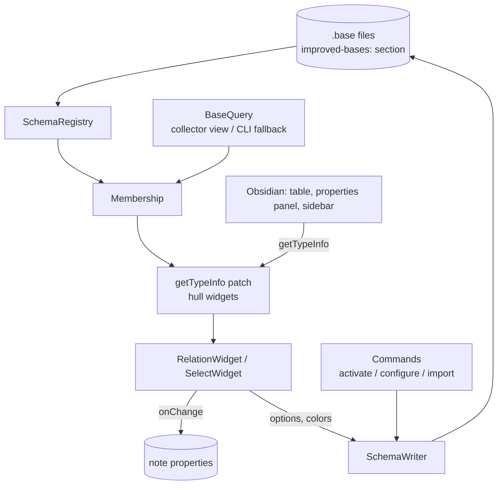

# Overview

## What this is

**Improved Bases** is an [Obsidian](https://obsidian.md) plugin (id `improved-bases`) that adds two field types to Obsidian Bases, defined per `.base` file: **relations** (a property whose values are wikilinks restricted to entries of another base) and **colored selects** (options with colors, editable in place). Field definitions live under an `improved-bases:` key inside the `.base` file itself; the plugin never writes to Obsidian's global `types.json`. The user-facing behavior, schema format and commands are documented in the [README](../README.md); development setup lives in [CONTRIBUTING](../CONTRIBUTING.md), and the original feasibility research in [SPIKE_FINDINGS](../SPIKE_FINDINGS.md).

The plugin is small (about 2,000 lines of TypeScript in `src/`) but sits on two undocumented Obsidian internals: it patches `metadataTypeManager.getTypeInfo` to swap in its own property widgets, and it reads Bases query results through a hidden Bases view (with the internal `base:query` CLI handler as a desktop fallback). Everything is feature-detected; when the internals are missing the plugin degrades to native rendering while the schema commands keep working. See [Obsidian internals](./architecture/obsidian-internals.md).

## Architecture at a glance

Read the diagram top-down: [`SchemaRegistry`](./modules/schema.md) finds every `.base` with a valid schema; [`BaseQuery`](./modules/query.md) watches the query result of each schema base and relation target; [`Membership`](./concepts/membership.md) joins both into "which schema applies to this file + property"; the [getTypeInfo patch](./concepts/hull-widget.md) consults it on every render and delegates to the [widgets](./modules/widgets.md); edits flow back either into note properties (`ctx.onChange`) or, for option changes, into the `.base` file through [`SchemaWriter`](./modules/schema.md). Layering detail: [Layers](./architecture/layers.md).

## Navigation

### Architecture

- [Layers](./architecture/layers.md) — the six layers from `.base` parsing to commands, and the dependency direction between them.
- [Obsidian internals](./architecture/obsidian-internals.md) — the undocumented API boundary, feature detection, and graceful degradation.

### Modules

- [Plugin core](./modules/plugin-core.md) — `main.ts` lifecycle and `settings.ts`.
- [Schema](./modules/schema.md) — types, parser, registry, writer, key safety.
- [Query](./modules/query.md) — `BaseQuery` watch abstraction and the hidden collector view.
- [Internals](./modules/internals.md) — feature detection, the `getTypeInfo` patch, CLI query, menu internals.
- [Widgets](./modules/widgets.md) — relation and select widgets, pickers, value helpers.
- [Commands](./modules/commands.md) — activate schema base, configure field, import option notes.
- [Tooling](./modules/tooling.md) — build, lint, unit tests, test vault, smoke and perf scripts.

### Flows

- [Plugin load and ready](./flows/plugin-load-and-ready.md) — from `onload` to the membership latch.
- [Widget render](./flows/widget-render.md) — how a table cell or panel row ends up with a plugin widget.
- [Schema edit](./flows/schema-edit.md) — writing a field or option into the `.base` and propagating it to open widgets.
- [Base query watch](./flows/base-query-watch.md) — collector mount, CLI fallback, remount on file events.

### Concepts

- [Schema base](./concepts/schema-base.md)
- [Field schema](./concepts/field-schema.md)
- [Membership](./concepts/membership.md)
- [Hull widget](./concepts/hull-widget.md)
- [Collector view](./concepts/collector-view.md)
- [Value mismatch](./concepts/value-mismatch.md)

### Guides

- [Add a field type](./guides/add-a-field-type.md)
- [Run tests and smoke checks](./guides/run-tests-and-smoke.md)

### Maintenance

- [Wiki log](./log.md) — generation and refresh history.
