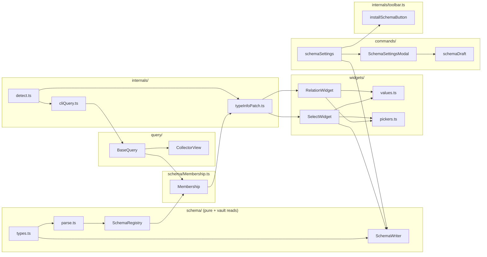

# Layers

## Summary

The plugin is a straight pipeline from **declared schema** to **rendered widget**, with one write path back into the `.base` file. Each `src/` directory is one layer; dependencies only point downward (towards schema types), never upward into widgets or commands. The composition root is `onload()` in [main.ts](../../src/main.ts) (see [Plugin core](../modules/plugin-core.md)).

## Diagram

## Key components

| Layer | Entry point | Role |
|---|---|---|
| Schema types + parser | `parseSchema()` in [parse.ts](../../src/schema/parse.ts) | Turns the raw `improved-bases:` YAML node into a validated [field schema](../concepts/field-schema.md); all-or-nothing per base. |
| Schema registry | `SchemaRegistry` in [SchemaRegistry.ts](../../src/schema/SchemaRegistry.ts) | Scans every `.base`, keeps the set of valid [schema bases](../concepts/schema-base.md), emits `changed`. |
| Query | `createBaseQuery()` in [BaseQuery.ts](../../src/query/BaseQuery.ts) | `watch(basePath, cb)`: live result set of a base, via the [collector view](../concepts/collector-view.md) or the CLI fallback. |
| Membership | `Membership` in [Membership.ts](../../src/schema/Membership.ts) | Joins registry + query into `resolve(filePath, propName)`; owns the readiness latch. See [Membership](../concepts/membership.md). |
| Patch | `installTypeInfoPatch()` in [typeInfoPatch.ts](../../src/internals/typeInfoPatch.ts) | Wraps `getTypeInfo` and returns [hull widgets](../concepts/hull-widget.md) for known field names. |
| Widgets | `RelationWidget`, `SelectWidget` in [widgets/](../modules/widgets.md) | Render chips/pills, pickers, and commit values via `ctx.onChange`. |
| Writer | `SchemaWriter` in [SchemaWriter.ts](../../src/schema/SchemaWriter.ts) | The only code that modifies a `.base`; edits `improved-bases.fields` byte-preservingly through the `yaml` document API. |
| Commands | [commands/](../modules/commands.md) | The schema settings dialog and its entry points (command, file menu, toolbar button); writes through `SchemaWriter`. |

## Design decisions

- **Schema lives in the `.base`, not in `types.json`.** A property can mean different things in different bases, and notes outside any schema base keep Obsidian's global types. This is why resolution is keyed on `(filePath, propName)` rather than on the property name alone.
- **One write path.** Widgets and commands never touch the `.base` text themselves; they hand a mutation `(fields: RawFields) => void` to `SchemaWriter.update()`, which applies it through `vault.process()`. Keeps YAML comments and ordering intact and makes mutations unit-testable as pure functions.
- **Readiness is a latch, not a flag.** `Membership.ready` only flips once the registry is loaded, every schema base has produced a result, the metadata cache is resolved, and the quiet period has elapsed. Before that, `resolve()` returns `null` and the hull falls back to native rendering. See [Plugin load and ready](../flows/plugin-load-and-ready.md).
- **Internals are isolated in `internals/`** and feature-detected at the boundary; the rest of the code depends on typed interfaces (`MetadataTypeManager`, `CliHandler`, `MenuInternals`). See [Obsidian internals](./obsidian-internals.md).
- **Injectable dependencies for tests.** `createBaseQuery(plugin, { mount, cli })` and `new Membership(registry, query, { cache, quietMs })` accept fakes; the unit tests in [test/](../modules/tooling.md) rely on this.

## Related

- [Overview](../OVERVIEW.md)
- [Obsidian internals](./obsidian-internals.md)
- [Widget render flow](../flows/widget-render.md)
- [Schema edit flow](../flows/schema-edit.md)
