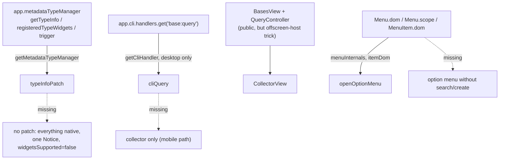

# Obsidian internals

## Summary

Improved Bases cannot be built on the public API alone: Obsidian exposes no way to register a property widget per base, and no public query API for Bases. The plugin therefore touches five undocumented surfaces. Every access goes through a detection function in [detect.ts](../../src/internals/detect.ts) or [menu.ts](../../src/internals/menu.ts) that returns `null` when the shape is unexpected, and every caller has a native fallback. The user-visible contract (one notice, widgets off, commands keep working, data never converted) is stated in the [README](../../README.md#unsupported-obsidian-versions).

## Diagram

## Key components

| Internal | Detector | Used by | Fallback when missing |
|---|---|---|---|
| `app.metadataTypeManager` (`getTypeInfo`, `registeredTypeWidgets`, `trigger`) | `getMetadataTypeManager()` in [detect.ts](../../src/internals/detect.ts); also requires `registeredTypeWidgets.text.render` | `installTypeInfoPatch()` in [typeInfoPatch.ts](../../src/internals/typeInfoPatch.ts); `widgetsSupported` in [main.ts](../../src/main.ts) | No patch installed, `widgetsSupported = false`, one `Notice`, settings toggle disabled. |
| `app.cli.handlers.get("base:query")` | `getCliHandler()` in [detect.ts](../../src/internals/detect.ts), returns `null` off desktop | `cliQuery()` in [cliQuery.ts](../../src/internals/cliQuery.ts) via `createBaseQuery` | `BaseQuery` runs collector-only; first scan waits for the collector push. |
| `QueryController.runQuery` only runs once the view container `isShown()` | not detected; relied on by `registerCollector()` in [CollectorView.ts](../../src/query/CollectorView.ts) | [Collector view](../concepts/collector-view.md) | Host is a real offscreen `div` in `document.body` (`styles.css` positions it); a hidden window can stall it, which is why the CLI runs first. |
| `Menu.dom`, `Menu.scope.register/keys`, `MenuItem.dom` | `menuInternals()`, `itemDom()` in [menu.ts](../../src/internals/menu.ts) | `openOptionMenu()`, `colorItem()` in [pickers.ts](../../src/widgets/pickers.ts) | Options remain clickable; no search/create input, no colored rows. |
| Bases toolbar DOM (`.bases-toolbar`), leaf `view.containerEl` / `view.file`, `.internal-embed[src]` | not detected; `resolveBasePath()` in [toolbar.ts](../../src/internals/toolbar.ts) returns `null` for unknown shapes | `installSchemaButton()` in [toolbar.ts](../../src/internals/toolbar.ts), registered by `registerSchemaSettings()` in [schemaSettings.ts](../../src/commands/schemaSettings.ts) | No button appears or the click shows a `Notice`; the command and the file menu item still open the dialog. |

All patching uses `monkey-around` (`around(mtm, { getTypeInfo })`) so the wrapper composes with other plugins and can be removed cleanly; `uninstall()` restores the original, clears the hull cache, closes open overlays and re-triggers `changed` for every known field so Obsidian rebuilds native widgets.

## Design decisions

- **Detect shape, not version.** `minAppVersion` in `manifest.json` is the floor; beyond that the plugin checks the actual members it needs. A future Obsidian that renames one internal degrades the affected feature only.
- **Never throw into Obsidian.** The `getTypeInfo` wrapper and every hull `render` are wrapped in `try/catch` and fall back to the original widget; a widget crash is logged and leaves the native widget in place.
- **CLI is a desktop-only accelerator, not the source of truth.** It does a synchronous full-vault scan and does not emit change events, so `BaseQuery` debounces CLI re-runs (200 ms) on vault/metadata events and hands over to the collector as soon as it pushes. Research behind this: [SPIKE_FINDINGS](../../SPIKE_FINDINGS.md), section F1.
- **The collector view is visible in the view selector.** Public `registerBasesView` has no hide flag; the plugin registers its own icon (`improved-bases-collector`) and hides the selector entry by that icon class in [styles.css](../../styles.css).

## Related

- [Internals module](../modules/internals.md)
- [Query module](../modules/query.md)
- [Hull widget](../concepts/hull-widget.md)
- [Base query watch flow](../flows/base-query-watch.md)
- [Layers](./layers.md)
