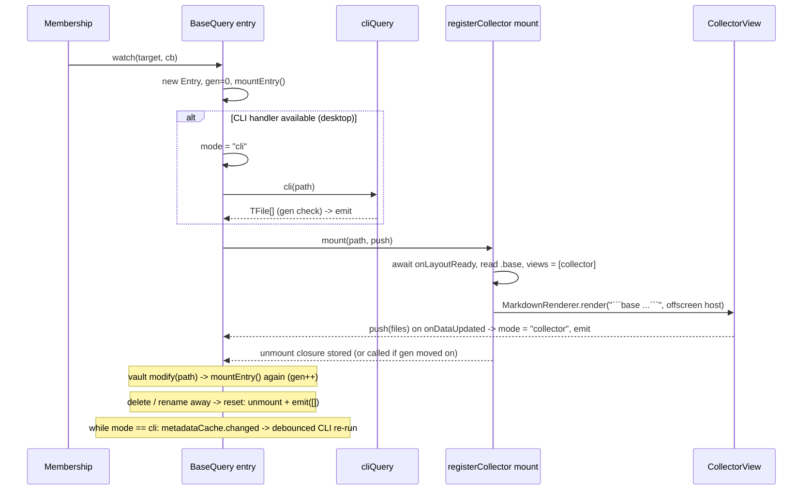

# Base query watch

## Summary

`BaseQuery.watch(target, cb)` in [BaseQuery.ts](../../src/query/BaseQuery.ts) gives [Membership](../concepts/membership.md) a live, deduplicated list of files in a base's result. Two sources feed it: the internal CLI `base:query` handler (desktop, synchronous full scan, fast first answer) and the [collector view](../concepts/collector-view.md) (public Bases API, live updates, works on mobile, but only runs once its host is shown). The first collector push wins and silences the CLI.

## Trigger

`Membership.sync()` calls `watch()` for every schema base and every relation target (a base plus optional view; each distinct `targetKey` is its own entry). Later vault events on that path drive remounts.

## Sequence diagram



## Steps

1. **First watch** creates an `Entry` and calls `mountEntry()`. Later watchers on the same path just subscribe and immediately receive `entry.last` if one exists.
2. **CLI first scan**: if `cliQueryAvailable()` ([cliQuery.ts](../../src/internals/cliQuery.ts)), the entry enters `cli` mode and runs the handler with `format: "paths"` (plus `view=` for a view target); the result is emitted if the generation is unchanged and the mode is still `cli`. A CLI failure logs a warning and emits `[]`.
3. **Collector mount** ([CollectorView.ts](../../src/query/CollectorView.ts)): waits for layout-ready, throws `BaseNotFoundError` if the file is gone, re-serializes the base YAML with `views` replaced by `[{ type: improved-bases-collector, collectorId }]` (for a view target: that view's config retyped as the collector, via `collectorSource()`), and renders it as a ```` ```base ```` block into a `div.improved-bases-collector-host` appended to `document.body` (positioned offscreen by [styles.css](../../styles.css)). A `Component` owns the host; unloading it removes the listener and the DOM.
4. **Hand-over**: `CollectorView.onDataUpdated()` pushes `this.data.data.map(e => e.file)`; the entry switches to `collector` mode, cancels any pending CLI timer and emits. From now on the Bases controller delivers updates itself.
5. **Dedup**: `emit()` skips results whose path list equals the last one, so listeners (and therefore membership refreshes) only fire on real changes.
6. **Events** act on all entries of the base (whole base and its views): `modify` on the base path remounts (gen++ invalidates in-flight results); `delete` or `rename` away resets to `[]`; `create`/`rename` to the path mounts a not-yet-mounted entry. In `cli` mode, `create`/`delete`/`rename` anywhere and `metadataCache.changed` schedule a 200 ms debounced CLI re-run, because the CLI has no change notifications of its own.
7. **Unwatch**: the returned closure removes the listener; the last listener unmounts and deletes the entry. `dispose()` unmounts everything and detaches the vault/metadata listeners.

## Failure modes

- `BaseNotFoundError` on mount: entry stays empty (`[]`) and unmounted until a `create` event for that path remounts it. Relation widgets show "Target base not found" in the picker.
- `ViewNotFoundError` (target view absent): entry stays unmounted until `modify`/`create` of the base; emits `[]` with `failed = true`, so Membership drops the target's result and the relation picker refuses to open ("View not found").
- Collector mount fails for another reason: if CLI mode is active, CLI refreshes continue; otherwise `[]` is emitted.
- Hidden window: `QueryController.runQuery` waits for `isShown()`, so the collector may not push until the window is visible; on desktop the CLI result bridges this. The smoke script expects the first result within 4.5 s ([Tooling](../modules/tooling.md)).

## Related

- [Query](../modules/query.md)
- [Collector view](../concepts/collector-view.md)
- [Obsidian internals](../architecture/obsidian-internals.md)
- [Plugin load and ready](./plugin-load-and-ready.md)
