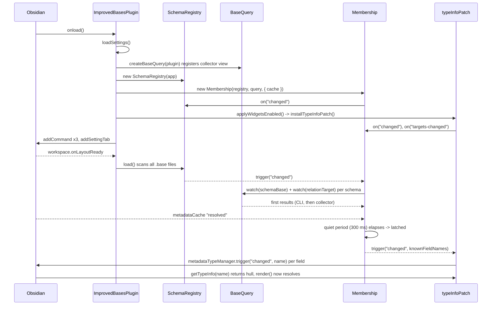

# Plugin load and ready

## Summary

Startup has two halves. `onload()` in [main.ts](../../src/main.ts) wires objects and installs the patch synchronously; nothing renders as a plugin widget yet because [Membership](../concepts/membership.md) is not latched. Readiness is reached asynchronously once the registry scan, every base query and the metadata cache have all settled for a quiet period; only then does the patch refresh and the table swaps native cells for plugin widgets (the brief native flash noted in the [README](../../README.md#what-it-does)).

## Trigger

Obsidian enables the plugin (startup or toggle in settings).

## Sequence diagram

## Steps

1. `loadSettings()` merges `data.json` into `DEFAULT_SETTINGS` ([Plugin core](../modules/plugin-core.md)).
2. `createBaseQuery(this)` registers the `improved-bases-collector` Bases view and icon ([Query](../modules/query.md)); no query runs yet.
3. `new Membership(...)` subscribes to registry `changed` and to `metadataCache.resolved`; `resolved` is pre-set if `resolvedLinks` already has entries. Its first `sync()` finds no schemas, so nothing is watched.
4. `widgetsSupported = getMetadataTypeManager(app) !== null`; if false, one `Notice`. `applyWidgetsEnabled()` installs the patch when enabled and supported. The patch's install-time `refresh()` is a no-op because `knownFieldNames()` is empty.
5. Commands and the settings tab are registered.
6. On `workspace.onLayoutReady`, `registry.load()` reads every `.base` (silent refreshes), sets `loaded = true`, triggers `changed`.
7. `Membership.sync()` computes the wanted set (every schema base plus every relation target base) and calls `query.watch()` for each. Field names of all changed schemas are collected as `affected`.
8. `BaseQuery` mounts each entry: CLI first scan if available, then the collector ([Base query watch](./base-query-watch.md)). Each result lands in `Membership.onResult()`, which re-arms the quiet timer.
9. When `registry.loaded`, every schema base has a result, `resolved` is true and 300 ms pass without a new push, `latched` flips to `true` and `changed` fires with all known field names.
10. `typeInfoPatch.refresh(names)` bumps the hull generation and triggers `metadataTypeManager.changed` per name; Obsidian re-asks `getTypeInfo` and re-renders, and `membership.resolve()` now returns fields ([Widget render](./widget-render.md)).

## Failure modes

- Internals missing: `installTypeInfoPatch()` returns `null`; `widgetsSupported` becomes `false`, the settings toggle is disabled, commands keep working ([Obsidian internals](../architecture/obsidian-internals.md)).
- No schema bases in the vault: `scanned` stays `false` (requires `schemas.length > 0`), the latch never flips, nothing is patched in practice.
- Hidden window: the collector can stall, so the CLI result (desktop) carries the first scan; on mobile the latch waits for the collector. See the performance notes in the [README](../../README.md#performance).

## Related

- [Membership](../concepts/membership.md)
- [Hull widget](../concepts/hull-widget.md)
- [Schema](../modules/schema.md)
