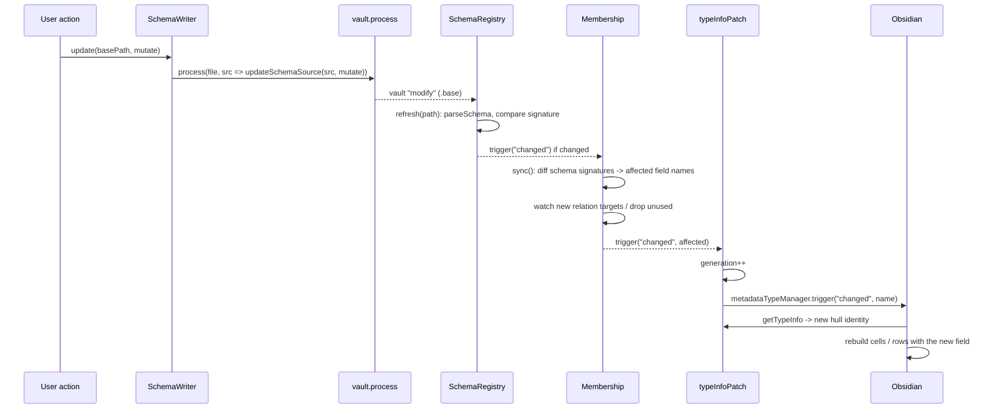

# Schema edit

## Summary

Every schema change, whether from a [command](../modules/commands.md) or from a [select widget](../modules/widgets.md) creating an option, is a pure mutation applied by `SchemaWriter.update()` through `vault.process()`. The resulting `modify` event is what the rest of the system reacts to: the registry re-parses, membership re-syncs, the patch refreshes, and widgets are rebuilt with the new [field schema](../concepts/field-schema.md).

## Trigger

- Command "Configure field" saves a `FieldDraft`.
- Command "Activate as schema base" / "Import option notes".
- `SelectWidget`: create an option from the menu, or recolor via right-click.

## Sequence diagram

## Steps

1. The caller builds a mutation `(fields: RawFields) => void`: `draftToMutation()` ([configureField.ts](../../src/commands/configureField.ts)), `importMutation()` ([importOptions.ts](../../src/commands/importOptions.ts)), `addOptionMutation()` / `setColorMutation()` ([values.ts](../../src/widgets/values.ts)).
2. `SchemaWriter.update()` ([SchemaWriter.ts](../../src/schema/SchemaWriter.ts)) runs `updateSchemaSource()` inside `vault.process()`: parse with the `yaml` document API, snapshot `improved-bases.fields`, mutate a clone, write only changed field nodes. Identical result → identical string → no disk write.
3. `BaseQuery` also sees the `modify` event on the same path and remounts the collector for that base ([Base query watch](./base-query-watch.md)), because filters or views may have changed.
4. `SchemaRegistry.refresh()` re-parses; a sequence number drops a stale read if another modify arrived meanwhile. `changed` fires only on a real signature or error change; a new error also shows a `Notice`.
5. `Membership.sync()` compares per-base field signatures with the previous run, collects the union of old and new field names of changed bases as `affected`, starts watching newly referenced relation targets, and stops watching bases no longer needed. If latched, it emits `changed(affected)` immediately; otherwise it re-arms the readiness quiet timer.
6. `typeInfoPatch.refresh(affected)` bumps the generation so `hullFor()` yields new hull objects, and triggers Obsidian's `changed` per field name. Obsidian rebuilds those cells; the next render goes through [Widget render](./widget-render.md) with the updated field.
7. In the select widget, the local `options` copy is updated optimistically right after the write resolves so the new pill shows its color before the refresh lands.

## Failure modes

- Base file missing: `SchemaWriter` throws `Base not found`; commands show a `Notice`, the select widget shows "Could not update the schema base" and does not commit the value.
- Mutation produces an invalid schema (for example an unknown color written by hand): the registry rejects the whole base, keeps the previous schema out, shows the first error as a `Notice`, and membership drops the base's fields, so its widgets revert to native.

## Related

- [Schema](../modules/schema.md)
- [Commands](../modules/commands.md)
- [Membership](../concepts/membership.md)
- [Schema base](../concepts/schema-base.md)
