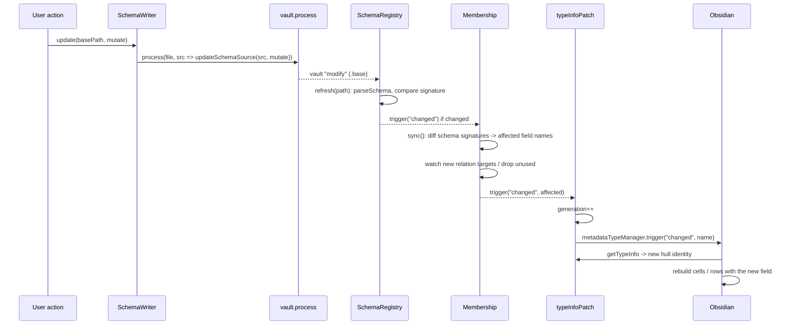

# Schema edit

## Summary

Every schema change, whether from the [schema settings dialog](../modules/commands.md) or from a [select widget](../modules/widgets.md) creating an option, is a pure mutation applied by `SchemaWriter.update()` through `vault.process()`. The resulting `modify` event is what the rest of the system reacts to: the registry re-parses, membership re-syncs, the patch refreshes, and widgets are rebuilt with the new [field schema](../concepts/field-schema.md).

## Trigger

- Save in the schema settings dialog (opened via toolbar button, file menu item or command): all `FieldDraft`s at once, as schema mutation plus column edits (add, rename, remove). A base without schema gets its `improved-bases` key on the first non-empty mutation.
- "Reset schema" for a base with an invalid section: `writer.reset()` replaces the section with an empty schema.
- `SelectWidget`: create an option from the menu, or recolor via right-click.

## Sequence diagram

## Steps

1. The caller builds a mutation `(fields: RawFields) => void` and optional `ColumnEdits`: `draftsToEdits()` ([schemaDraft.ts](../../src/commands/schemaDraft.ts)), `addOptionMutation()` / `setColorMutation()` ([values.ts](../../src/widgets/values.ts)).
2. `SchemaWriter.update(basePath, mutate, edits)` ([SchemaWriter.ts](../../src/schema/SchemaWriter.ts)) runs `updateBaseSource()` ([baseDoc.ts](../../src/schema/baseDoc.ts)) inside one `vault.process()`: parse with the `yaml` document API, apply the column edits to every view's `order`, `summaries`, `sort`, `groupBy` and to `properties:`, snapshot `improved-bases.fields`, mutate a clone, write only changed field nodes. Filter and formula expressions are left alone. Identical result → identical string → no disk write.
3. `BaseQuery` also sees the `modify` event on the same path and remounts the collector for that base ([Base query watch](./base-query-watch.md)), because filters or views may have changed.
4. `SchemaRegistry.refresh()` re-parses; a sequence number drops a stale read if another modify arrived meanwhile. `changed` fires only on a real signature or error change; a new error also shows a `Notice`.
5. `Membership.sync()` compares per-base field signatures with the previous run, collects the union of old and new field names of changed bases as `affected`, starts watching newly referenced relation targets, and stops watching bases no longer needed. If latched, it emits `changed(affected)` immediately; otherwise it re-arms the readiness quiet timer.
6. `typeInfoPatch.refresh(affected)` bumps the generation so `hullFor()` yields new hull objects, and triggers Obsidian's `changed` per field name. Obsidian rebuilds those cells; the next render goes through [Widget render](./widget-render.md) with the updated field.
7. After a dialog save with renamed or removed fields, `migrateRenames()` and `removeProperties()` ([schemaSettings.ts](../../src/commands/schemaSettings.ts)) rename or delete the property keys in the member notes whose frontmatter on disk has the exact key through `fileManager.processFrontMatter`, one file at a time; notes with both keys are skipped on rename. A `Notice` reports renamed, skipped, failed and removed counts, and warns "Filters or formulas still reference 'X', update them manually" when `referencesName()` finds the old name in filter or formula expressions. This happens after the base write, so the notes follow the new field names. Both are skipped, with a notice, when the members are unknown.
8. In the select widget, the local `options` copy is updated optimistically right after the write resolves so the new pill shows its color before the refresh lands.

## Failure modes

- Base file missing: `SchemaWriter` throws `Base not found`; the dialog shows the error and stays open, the select widget shows "Could not update the schema base" and does not commit the value.
- Mutation produces an invalid schema (for example an unknown color written by hand): the registry rejects the whole base, keeps the previous schema out, shows the first error as a `Notice`, and membership drops the base's fields, so its widgets revert to native.

## Related

- [Schema](../modules/schema.md)
- [Commands](../modules/commands.md)
- [Membership](../concepts/membership.md)
- [Schema base](../concepts/schema-base.md)
