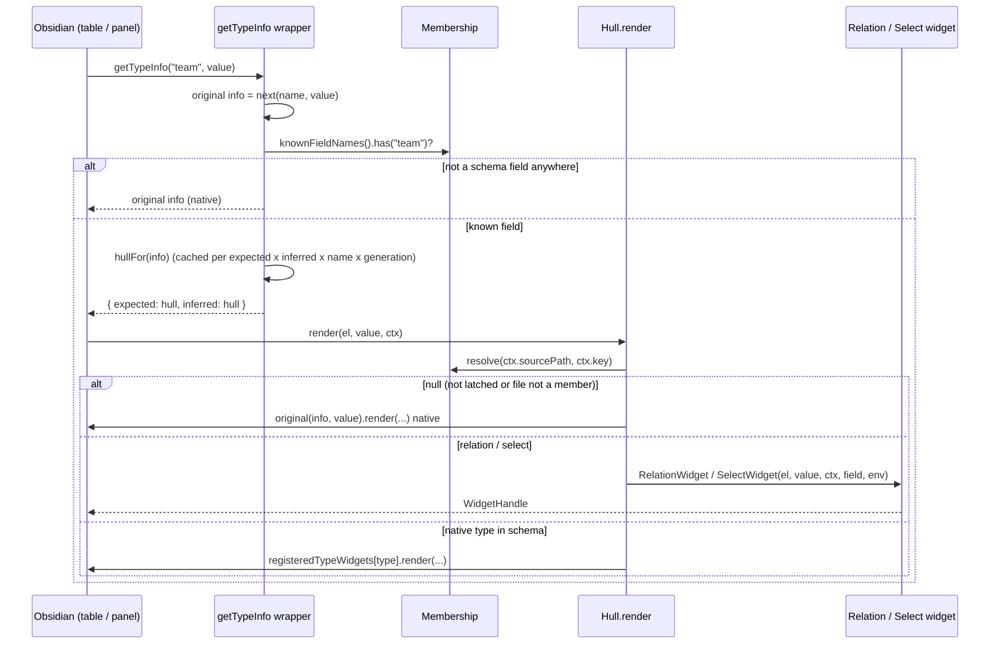

# Widget render

## Summary

Obsidian decides which widget draws a property by calling `metadataTypeManager.getTypeInfo(name, value)`. The plugin's patch answers with a [hull widget](../concepts/hull-widget.md) for every property name that appears in any schema; the hull defers the real decision to render time, when `ctx.sourcePath` is known and [Membership](../concepts/membership.md) can say whether that file belongs to a schema base that defines the field.

## Trigger

Obsidian renders a property: a Bases table cell, a row in the note's properties panel, or the sidebar "File properties" view. Also after `refresh()` forces a rebuild.

## Sequence diagram

## Steps

1. The wrapper installed by `installTypeInfoPatch()` in [typeInfoPatch.ts](../../src/internals/typeInfoPatch.ts) calls the original `getTypeInfo`, then checks `membership.knownFieldNames()` (lowercased union of all schema field names). Unknown names pass through untouched.
2. `hullFor(info, name)` returns a cached hull keyed on the original `expected`/`inferred` pair, the lowercase field name and the current `generation`. The hull copies `type`, `icon`, `name` from `expected`, has a shape-based `validate` (via `membership.shapesFor(name)`, falling back to the original `validate`), and a `render` closure.
3. Obsidian renders. The hull calls `membership.resolve(ctx.sourcePath, ctx.key)`. `ctx.key` is lowercase from the table and original-case from the panel; `resolve` lowercases, and for files in several schema bases picks the first by path with a one-time console warning.
4. `renderPlugin` first finds the base behind the surrounding view (`baseContextOf(app, el)` in [baseContext.ts](../../src/internals/baseContext.ts): Bases tab or embedded `.base`, null in the panel, sidebar and code-block bases) and resolves with it as `preferredBase`. With competing definitions (`res.others`) it appends an info marker after the widget. Bases builds table cells detached, so when `el` is not yet connected the context is checked again in a `setTimeout(0)`: a different winner re-renders the cell, the same winner only refreshes the marker text; the returned handle delegates `focus()` to the latest widget. Dispatch: `relation` → `RelationWidget`, `select` → `SelectWidget` ([Widgets](../modules/widgets.md); a click on the field opens the option picker); a native schema type → the widget registered under that id (`registeredTypeWidgets[type]`, an unregistered id falls through to the original), overriding `types.json` for members; `null` → `original(info, value)`, which is the untouched `expected` when it validates the value, else `inferred`.
5. The widget draws into `el`, registers overlays it opens, and commits edits with `ctx.onChange(...)` in the schema's storage shape (string or list per `multiple`, see [Value mismatch](../concepts/value-mismatch.md)). Obsidian writes the property; the plugin never touches note files directly.
6. Widget exceptions are caught in the hull: logged, `el` cleared, native widget rendered instead.

## Failure modes

- Patch inactive (`active = false` after uninstall): wrapper returns original info; hulls already handed out render native.
- `getTypeInfo` returns info without `expected`/`inferred`: passed through unchanged.
- Relation target base missing: chips still render (via `LinkValue`), the picker is not opened, only a `Notice` ("Target base not found") is shown.
- Relation entry icons are read at render time (`icon` property of the destination note, else the target base's default icon via `membership.baseIcon()`); a later change of either shows up on the next render of the cell or row, not live.

## Related

- [Hull widget](../concepts/hull-widget.md)
- [Internals](../modules/internals.md)
- [Plugin load and ready](./plugin-load-and-ready.md)
- [Schema edit](./schema-edit.md) (how `refresh` re-triggers this flow)
